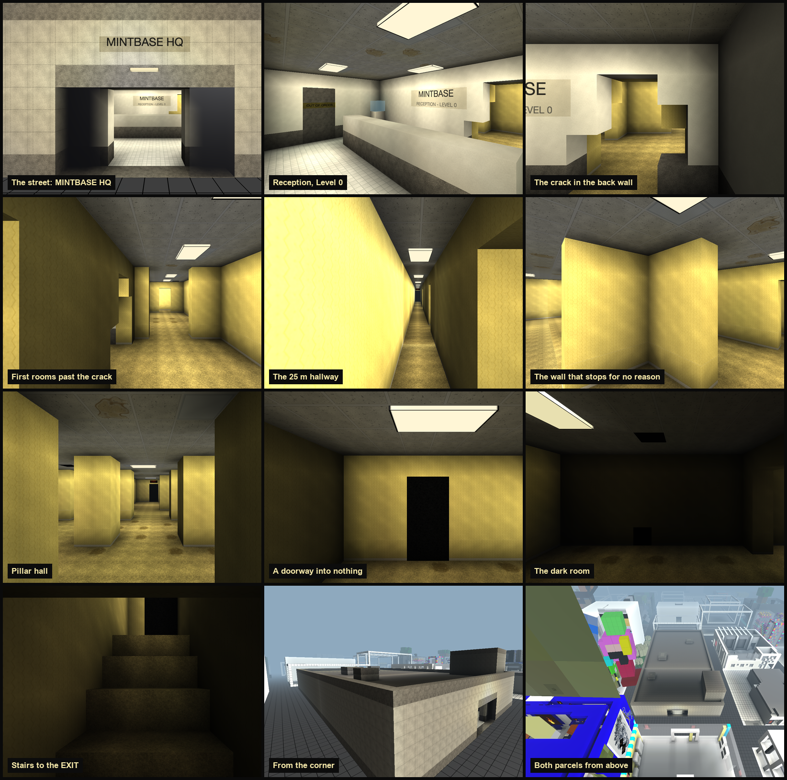

# Mintbase HQ + Showroom: Backrooms Level 0



This turns two adjacent Voxels parcels into one Backrooms block. [#1297 Mintbase HQ](https://www.voxels.com/parcels/1297)
covers z 110–121 and [#1342 Mintbase Showroom](https://www.voxels.com/parcels/1342) covers z 121–143. Both span x −344..−327,
and streets run on all four sides.

From the street it's a plain beige office block with one door. Inside there's a small reception with a desk, an
out-of-order elevator and a water cooler. A crack in the back wall of the reception opens onto Level 0, which
continues through the rest of both parcels:

- a 25 m hallway, with a void doorway and an EXIT sign at its far end
- damp rooms and a pillar hall
- a dark room
- a stair that climbs into a black EXIT door

Fluorescent troffers and a looping ballast hum run throughout.

## Layout

| Path | What |
|---|---|
| `gen/textures.py` | the 1024 px tileset (wallpaper, carpet, drop ceiling, troffers, facade…) → `out/assets/tileset.png` |
| `gen/hum.py` | seamless 8 s ballast hum → `out/assets/hum.wav` |
| `gen/level0.py` | the build: plan → voxels → features → `out/1297.json`, `out/1342.json` (+ `out/plan.txt`) |
| `preview/shoot.mjs` | real-engine preview: the live Voxels client in headless Chrome with the build swapped in at the network layer |
| `backup/` | local only (not committed): both parcels as they were on 2026-09-29, the last 50 history versions, and `*-RESTORE-original.json` import files |

## Regenerate

```bash
python3 gen/textures.py && python3 gen/hum.py
python3 gen/level0.py https://cdn.jsdelivr.net/gh/nategeier/mintbase-backrooms@v1.0.0/out/assets
node preview/shoot.mjs            # or: node preview/shoot.mjs hallway pillars
```

`level0.py` takes the asset base URL. The committed JSON points at the `v1.0.0` tag on jsDelivr, so changed
assets need a new tag. The JSON references `<base>/tileset.png` and `<base>/hum.wav`. The preview
serves `https://assets.backrooms.test/*` from `out/assets/`, so run the generator without an argument before
previewing. The first time the owner edits in-world, Voxels copies external assets into its own storage (`ugc://`).

## Import (the owner, or a collaborator)

1. Open `https://www.voxels.com/parcels/1297/edit`.
2. Under **edit history**, click **Take snapshot**, then choose `out/1297.json` in the file picker. The import runs
   as soon as the file is chosen, with no confirmation.
3. Repeat on `/parcels/1342/edit` with `out/1342.json`.

To undo, click an older entry in the same edit-history table (it asks to confirm the revert), or import
`backup/<id>-RESTORE-original.json`.

## How Voxels works (read from its client, 2026-09)

- **Voxel field:** `base64(zlib(Uint16 LE))`, C-order `[x][y][z]`, 0.5 m voxels. Its shape is exactly
  `(x2-x1)*2 × (y2-y1)*2 × (z2-z1)*2`.
- **Voxel value:** `0x8000 | tint<<5 | texture`. The texture index is 1–16 and indexes a 4×4 atlas; 16 wraps to cell
  0. Glass is `tint<<5 | 2`, with no `0x8000` flag. The palette holds 8 tints.
- **Layer 0 sits under the island ground**, which draws over its top face, so floors go on layer 1 (walking surface
  at 0.75 m).
- **Lighting is baked per parcel.** It floods from each lantern's voxel, falling off by 0.9 per voxel straight on
  and 0.6 per voxel sideways. Any open parcel edge counts as sky. On top of that, one hemispheric "sun" shades faces
  by direction, so ceilings (facing down) top out around 40 % of their texture brightness.
- **Lanterns** render as glowing boxes, so here they are the troffers. The limit is 20 per parcel. Signs and images
  are full-bright.
- **Players:** the capsule is 1.6 m tall, eye height is 1.65 m, and autostep handles 0.6 m, so 0.5 m voxel stairs
  can be walked up.
